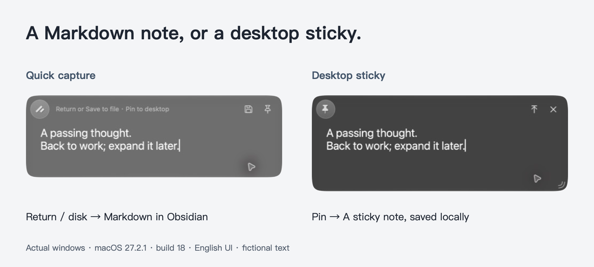

# 2ndJot · 双轨记

**Stay on track. Jot it down.**

[简体中文](README.zh-CN.md) · [Changelog](CHANGELOG.md) · [Contributing](CONTRIBUTING.md)

An idea arrives while you're writing or researching. 2ndJot is a macOS menu bar utility that lets you capture it with a shortcut, save it as local Markdown in Obsidian or pin it to your desktop, then return to your work.

> **Private preview · 1.6.0 (build 18).** There is no public download yet. Build from source if you have repository access, or use a shared preview package.

The English name **2ndJot** is pronounced “Second Jot.” The Chinese name is **双轨记**.



Capture and desktop-sticky window preview with fictional example text.

## One entry point, two destinations

Press **Control + Shift + Space** to open the capture panel. The shortcut is configurable.

| Where the idea goes | Action and result |
| --- | --- |
| Your note library | Press Return or click the floppy-disk button to create a separate UTF-8 `.md` file. Optionally open it in Obsidian after saving. |
| Your desktop | Click the pin to create a sticky note. Text, position, and size are saved locally and restored on relaunch. Closing a note asks whether to save a Markdown copy by default. |

In a sticky note, Return inserts a line break and `Command + Return` saves a Markdown copy. Drag the upper-left circle to move it; use the lower-right arcs to resize. Capture and sticky notes have separate glass settings, with different tint strengths by default.

Typing and dictation use your current input method. 2ndJot does not record audio, include AI speech recognition, or change input method settings.

## Install and get started

1. Obtain the shared `2ndJot-1.6.0-arm64.zip` and its matching checksum file, or [build from source](#development-and-contributions). Public [Releases](https://github.com/SinyveZ/2ndJot/releases) will become a download entry point only after public release.
2. Unzip and move `2ndJot.app` into `~/Applications`. Quit an existing version before upgrading.
3. Open the app, right-click its menu bar icon, then choose **Settings → General → Save Location**. Select a local Obsidian vault or a folder inside it.
4. Press **Control + Shift + Space**, enter a thought, and press Return to save. Click the pin instead to keep a sticky note.

**The save-location picker currently requires an Obsidian vault**: it checks for the vault's `.obsidian` directory and does not accept arbitrary folders. Desktop sticky notes work independently, without Obsidian. You can also disable **Open in Obsidian after saving** to write captures to the selected vault without opening Obsidian.

Left-click the menu bar icon to capture; right-click for the menu.

## Interface language

The app supports **English and Simplified Chinese** and follows your system language by default. In **Settings → General → App language** (中文：**设置 → 通用 → 界面语言**), choose **System default**, **简体中文**, or **English**. App-owned menus, settings, prompts, and errors update immediately, without restarting.

Switching language preserves note text, custom hints, shortcuts, the save location, and glass settings. Native macOS dialogs follow the macOS language; existing folder and file names remain unchanged. The app does not change your system language preferences.

## Compatibility and first launch

- The app ZIP is **Apple Silicon (arm64) only**. Local testing covers **Apple Silicon / macOS 27.2.1**. Intel and other macOS versions have not been tested on hardware.
- The deployment target is macOS 13; this is not a claim that every supported system has been tested. Liquid Glass is used on macOS 26+, with native vibrancy on earlier systems. Interactive glass effects need macOS 27.
- Builds use an **ad-hoc signature**, without Developer ID signing or Apple notarization. macOS may block a downloaded copy. Verify the source and checksum, then consult [Apple's first-launch guidance](https://support.apple.com/en-us/102445), or build from source.

In the package directory, run the command below and compare its result with the matching filename in `2ndJot-1.6.0-SHA256SUMS.txt` supplied with the same build:

```sh
shasum -a 256 "2ndJot-1.6.0-arm64.zip"
```

If macOS says the developer cannot be verified or Apple cannot check the app for malicious software, proceed only if you have verified the source and choose to trust the app. After trying to open it, use **System Settings → Privacy & Security → Open Anyway** and confirm the prompt, as described by Apple. If macOS reports damage or that the app will harm your computer, stop the installation and report the exact message.

Local development uses macOS 27.2.1 and SDK 27.2. Installation from a fresh download on another Mac has not been verified. See the [verification record](docs/launch/VERIFICATION.md) for actual local and CI results and remaining test gaps.

## Data and privacy

- Markdown is written to the selected local vault. Drafts and sticky notes are stored in `~/Library/Application Support/YinSu/`, without additional encryption.
- There is no built-in account, cloud recognition, or analytics upload. Your input method controls its speech service; Obsidian controls its sync.
- Copying saved text to the clipboard is enabled by default and can be disabled in Settings. Diagnostic logs at `/tmp/YinSu.log` may contain local paths; redact them before sharing.

The rename retains `com.sinyve.YinSu`, the `YinSu` executable, and existing data locations. Existing shortcuts, save locations, and other settings are preserved; old notes are not moved or renamed.

## Development and contributions

The app uses Objective-C / AppKit and clang, with no third-party runtime dependencies. Building requires Xcode Command Line Tools and a macOS 26+ SDK. Tests and packaging also require Python 3:

```sh
./build.sh        # /private/tmp/YinSu-build/2ndJot.app
./tools/check.sh  # isolated checks; requires a logged-in macOS GUI session
```

The check script runs 21 application scenarios in each language, plus localization-resource and two geometry checks. This describes its coverage; completed results are recorded separately. For an isolated English or Chinese settings preview, use `./tools/preview.sh settings en` or `./tools/preview.sh settings zh-Hans`.

See [development notes](docs/DEVELOPMENT.md) for build and test details, and the [brand design (Chinese)](docs/BRAND_DESIGN.md) and [G3 profile (Chinese)](docs/G3_CORNERS.md) for the D mark of two offset tracks and the shared corner geometry.

Preview testers with repository access can use [Issues](https://github.com/SinyveZ/2ndJot/issues); otherwise, send feedback to the person who shared the package. Include the app version, macOS version, chip, interface language, and reproduction steps; omit real notes and private paths. Read the [contribution guide](CONTRIBUTING.md) before proposing changes, and the [security policy](SECURITY.md) for security reports. This is a personally maintained project with no guaranteed response schedule.

## License

[MIT](LICENSE). 2ndJot is an independent project, unaffiliated with Obsidian, WeType, or Apple.
