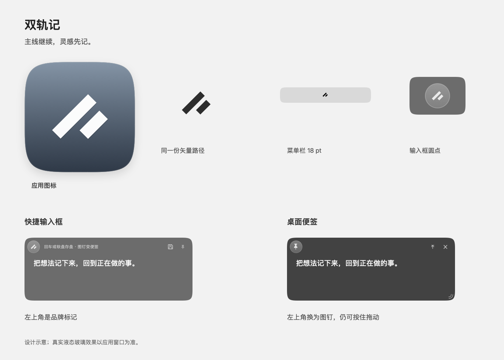
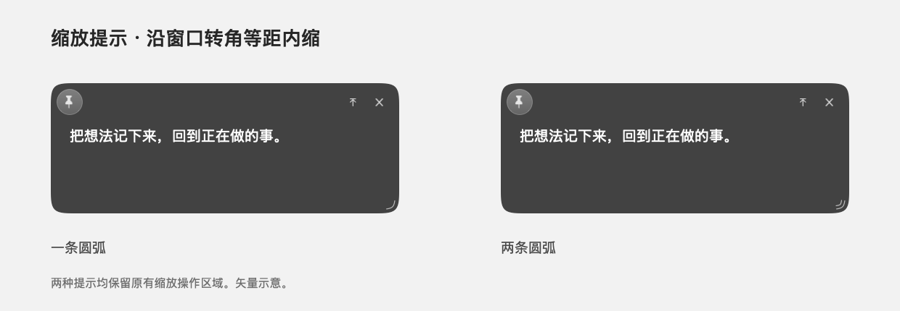

# 双轨记的错位双轨标记

2026-11-17 已批准品牌：中文名「双轨记」，英文品牌 **2ndJot**（读作 **Second Jot**，second 的序数缩写为 `2nd`）。理念为：**主线继续，灵感先记。** 英文主张为 **Stay on track. Jot it down.**，给临时想法一个去处，再继续眼前的工作。

长轨代表正在推进的工作，短轨代表先记下、待处理的灵感。标记采用 D“错位双轨”：两条同向、长短与位置彼此错开的斜轨，保留 D 方案的形状和比例。



D 原形见统一标记 [2ndJotMark.svg](media/2ndJotMark.svg)。上图为设计示意，真实窗口见 [README 的实机图](media/workflow-preview.png)。原批准稿 [brand-approved.png](media/brand-approved.png) 保留作历史参考，其中的英文拼音是确定 2ndJot 以前的占位名称。

## 版本与验证

当前为 `1.6.0（build 18）` 私有预览，尚未公开发布。构建、双语检查、实机观察和 CI 实际结果统一见[验证记录](launch/VERIFICATION.md)。

## 同一个形状，三处使用

- 输入框左上圆点：20 点矢量图像，沿用原来的磨砂底和拖动区域。
- macOS 菜单栏：18 点单色模板图标，由系统适配菜单栏的颜色。
- 应用图标：相同的矢量路径置于冷灰磨砂圆角底上，构建时生成 16–1024 像素的 ICNS。

应用图标采用品牌板中的冷灰磨砂背景与白色标记；单色版本跟随所在环境。界面字体、按钮间距和液态玻璃设置沿用现有设计。

英文界面保持相同的布局、材质、图标与交互。可在“设置 → 通用 → 界面语言”（Settings → General → App language）中即时切换中英文，默认跟随系统；不翻译用户正文、自定义提示或实际文件夹名称。系统对话框仍遵循 macOS 的语言。

标记几何源在 `src/YSBrandMark.h`，应用图标绘制共用 `src/YSBrandIcon.h`，统一 SVG 资源为 [2ndJotMark.svg](media/2ndJotMark.svg)。实际 ICNS 与宣传图直接共享绘制，实现同型、同色、同比例。`./tools/render-brand.sh` 为预览与 SVG 的生成入口；`build.sh` 构建时生成应用图标资源。

## 更名与兼容

| 项目 | 品牌更名后的约定 |
| --- | --- |
| 应用包 | `2ndJot.app` |
| 应用内品牌 | 中文“双轨记”／英文“2ndJot” |
| 应用 ZIP | `2ndJot-1.6.0-arm64.zip` |
| 源码 ZIP／解压目录 | `2ndJot-1.6.0-source.zip`／`2ndJot-source` |
| 校验文件 | `2ndJot-1.6.0-SHA256SUMS.txt` |
| 构建根／包内可执行文件 | `/private/tmp/YinSu-build`／`YinSu` |
| Bundle ID／用户设置域 | `com.sinyve.YinSu` |
| 数据目录 | `~/Library/Application Support/YinSu` |
| 日志 | `/tmp/YinSu.log` |
| 环境变量 | 沿用现有 `YIN_SU_*`、`VOICE_NOTE_*` 名称 |
| 旧笔记目录 | 沿用用户设置，不移动或改名 |

更名历史：1.3.0 及以前为「语音速记 / VoiceNoteBridge」；1.4.0 起为「音速 / YinSu」；1.6.0 采用中文“双轨记”，英文最终定为“2ndJot”。当前 build 18 统一应用与制品名称。早期标记、品牌板及英文占位名称仅作历史参考，不作为当前品牌展示。

## 便签状态

左上圆点中的双轨标记变为图钉，圆点位置和拖动方式保留。顶部中央保持留白。转换时固定窗口上沿和左边缘，较高的便签向下展开；图钉沿用简短的淡入、轻压动画，恢复旧便签时静止。

## 缩放提示



外轮廓统一采用 [G3 连续曲率](G3_CORNERS.md)。右下两条短弧取自窗口真实转角的中段，沿法线分别内缩 5.5、10 点，线宽 1.2 点、圆头；缩放操作区域保持原样。两条线与外边缘等距，缩放时使用对角光标。单弧版本仍供隔离预览比较。

实机比较入口：

```sh
YIN_SU_RESIZE_ARCS=1 ./tools/preview.sh light zh-Hans
./tools/preview.sh light en
```

预览的应用身份、数据、设置均隔离，不与正在运行的日常版共享焦点身份。
