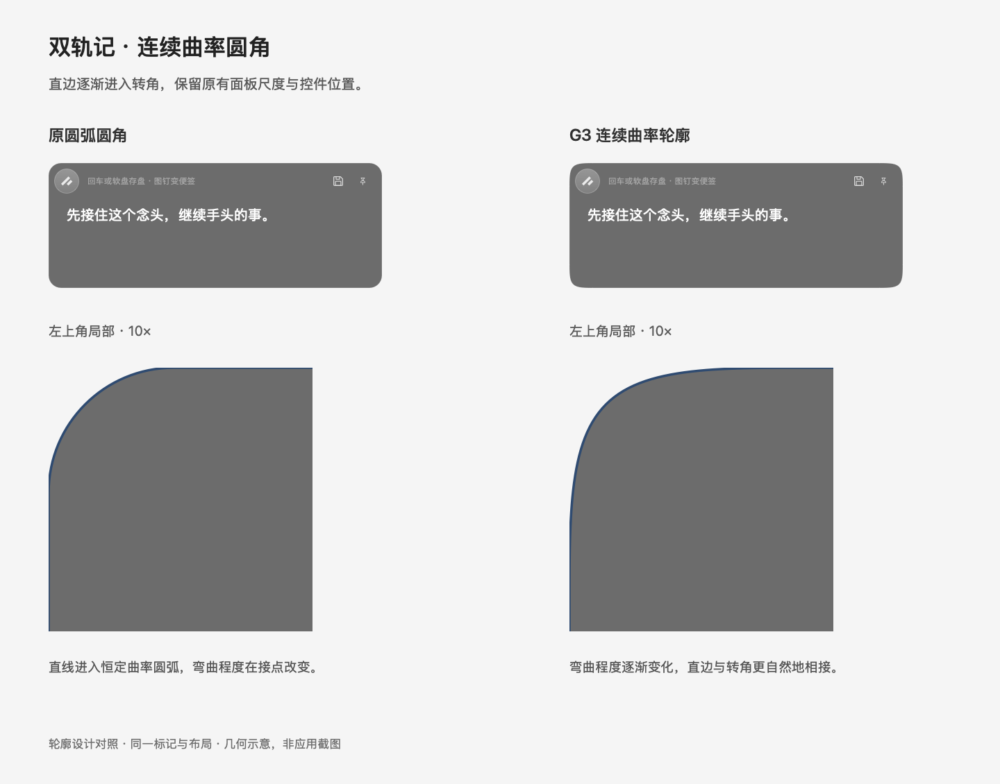

# 连续曲率的圆角

双轨记的快捷输入框、桌面便签、设置分组卡片，以及自绘应用图标和功能图解，使用同一套连续曲率轮廓。窗口尺寸、正文位置和拖动入口保留。

## 直边怎样进入转角

G3 连续要求相接轮廓的切线方向、曲率与曲率变化率连续，参见 [Autodesk 的连续性说明](https://help.autodesk.com/cloudhelp/2027/ENU/Alias-Video-Tutorials/files/essential-concepts/continuity-g0-g1-g2-g3.html)。这里使用五次曲线，使直边接入处的曲率和曲率变化率都归零，再逐渐进入转角。

几何定义在 `src/YSG3Corners.h`。单位角的控制点为 `(0,0), (0.2,0), (1,0), (1,0), (1,0.8), (1,1)`；两端一至三阶导数都沿各自直边方向，且一阶导数非零。四个角旋转对称，连接相同的直边。

原有“18 点圆角”作为视觉尺度保留：新轮廓在 45 度方向的内缩量与旧圆弧相同，同时把过渡延伸到直边。极小尺寸会缩短过渡范围，避免转角相交。它不再表示一段固定半径的圆弧。

Core Graphics 以三次贝塞尔片段显示这条五次曲线，适应细分将轮廓误差控制在 0.003 点以内。几何连续性针对解析曲线定义，屏幕路径是子像素精度的近似。

## 材质和裁切

输入框与便签由根视图统一裁切玻璃、染色和正文；边缘描线也来自同一轮廓。内部玻璃或旧系统磨砂不再另加圆弧裁切，避免两条不同的轮廓相互切掉边缘。缩放后同步更新遮罩，保持 `hasShadow = NO`。

左上磨砂拖动点继续为圆形。右下缩放提示从窗口真实 G3 转角截取短段，沿法线向内等距偏移，让两条线随外轮廓走，避免各自缩成更小的独立圆角。保留原有操作区域，使用对角缩放光标；拖动期间固定同一光标，松开或取消后交回系统管理。系统原生按钮和设置窗口框架沿用 macOS 自身外观。

## 验证

`./tools/check-g3.sh` 检查曲率、曲率变化率、正则性、凸性、边界、对称和实际绘制误差。应用的 `--corner-check` 检查快捷框／便签的根遮罩、最小尺寸与缩放、底层材质裁切、拖动命中及无窗口阴影。`--resize-check` 覆盖对角光标、拖动期间的光标保持、松开／取消／移除后的清理，以及连续缩放的锚点和尺寸限制。

运行 `./tools/render-corner-design.sh` 可重新生成上面的轮廓对照。当前实际结果记录在 [本地验证记录](launch/VERIFICATION.md)。
