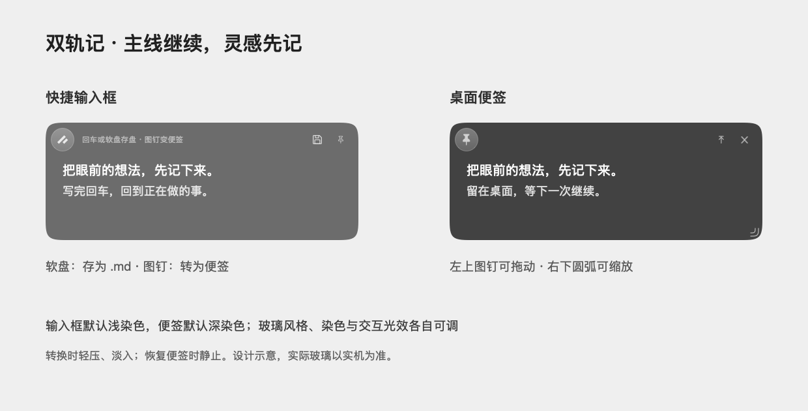

# 便签与快捷输入框的状态区分

双轨记（2ndJot，读作 Second Jot）采用 D“错位双轨”品牌标记，理念为“主线继续，灵感先记。”长轨代表当前工作，短轨代表先记下、待处理的灵感。便签沿用现有原生图钉与磨砂材质；图钉是便签状态标记，置顶／置底仍由右上角箭头独立控制。

当前为 `1.6.0（build 18）` 私有预览，尚未公开发布。构建、双语检查、实机观察与 CI 实际结果统一见[验证记录](launch/VERIFICATION.md)。

下列状态图与 GIF 由当前共享绘图组件生成，使用已批准的 D 标记与连续曲率轮廓；它们是设计示意，实际材质见应用窗口。

[动效设计示意 GIF](media/sticky-pin-motion.gif) 使用当前应用共享矢量组件绘制，不是屏幕录像。

## 形态与空间

- 快捷输入框：顶部保留提示文字，右上并列软盘与图钉。软盘存为 Markdown，图钉只转为便签。
- 桌面便签：左上圆点中的双轨标记换为原生 `pin.fill` 图钉，继续按住拖动。
- 左上圆点仍为 36 点直径，位于左上角 8 点处；图形占用 20 点区域，状态变化不增加其他装饰。
- 左上圆点与右侧操作控件的中心线统一距顶部 26 点；正文继续从原有内容区开始。
- 调整尺寸时圆点固定在左上角；转换便签时保留窗口上沿与左边缘，最小尺寸仍为 280×180 点。
- 顶部中央不添加图案。移动只使用左上圆点；右下以两条连续曲率短弧提示缩放。

## 分开的玻璃外观

两组设置分别位于设置页的“通用”和“便签”，风格、染色强度、交互光效以及恢复默认互不影响。

英文对应 **General** 和 **Sticky Notes**。应用默认跟随系统语言，也可在 **Settings → General → App language**（设置 → 通用 → 界面语言）中即时切换。切换不改两组玻璃偏好、正文、自定义提示、快捷键、保存位置及便签状态；系统对话框使用 macOS 的语言。

| 项目 | 快捷输入框默认 | 桌面便签默认 |
| --- | --- | --- |
| 玻璃风格 | 标准 | 标准 |
| 染色强度 | 10% | 50% |
| 交互光效 | 开启（系统支持时） | 关闭 |

默认都采用标准玻璃，保证浅色背景下白字可读；深浅染色使钉下来的变化明显。通透作为可选风格保留，适合深色或彩色背景。染色强度范围是 0–60%，它不是窗口透明度百分比。

旧版显式设置过共享玻璃参数时，会保留原来的有效组合给快捷输入框，包含没有显式写入的旧默认参数；新便签使用独立默认外观。新格式已有设置优先，旧键保留，不反复覆盖。现有便签、后续新建便签和重启恢复的便签都采用便签配置。

macOS 13–25 使用原生磨砂，仍可分别调节染色；玻璃风格需 macOS 26，交互光效需 macOS 27。

## 两个入口与关闭便签

软盘与回车直接复用 `commitEditor`，包含空内容处理、写入验证、打开失败保留原文和避免重复保存。右上两按钮与便签的箭头／关闭按钮沿用相同尺寸、中心线和间距；顶部提示为两个按钮预留空间。

图钉只创建可恢复的便签，不写 Markdown。便签关闭策略默认“每次询问”，可选仅关闭、取消或“另存速记并关闭”；原有自定义关闭策略不重置。

## 转换与动效

转换时首先保存便签、采用便签自己的玻璃外观，收起快捷输入框，然后播放约 0.28 秒的淡入和轻压。动画只作用于左上图钉，窗口与正文保持稳定。明确动画时钟，避免文件写入和首帧提交将视觉结束时间拖长。

新建空白便签也会播放同样的动画；启动恢复的便签直接显示静态标记。系统开启“减少动态效果”时不播放变换动画。切换置顶／置底不会移除标记或重播动画。

## 实现与验证

- `src/YSPanelChrome.h`：共用磨砂材质、图钉、软盘和圆弧；`src/YSBrandMark.h` 提供统一品牌几何，配套 SVG 为 `docs/media/2ndJotMark.svg`。
- `src/main.m`：状态视图、短动画、便签创建／恢复路径和缩放布局。
- `src/YSLocalization.h` 与 `src/Resources/`：中英文文字、语言偏好及回退；保留共用布局与图形。
- `tools/render-pin-design.sh`：生成对照 PNG 与动效 GIF。
- `tools/check.sh`：中英文各 21 个应用场景，共 42 个，含普通动画、减少动态效果和语言切换；另有本地化资源、G3 轮廓与缩放弧线检查。此处说明检查范围，不代替运行结果。

现有自检覆盖最小尺寸下的左上位置、拖动命中和转换锚点、动画中间帧与结束、正文保留，以及旧便签恢复时标记静止。实机检查包括玻璃默认差异、两组设置、软盘保存与便签关闭另存；实际执行结果统一见[验证记录](launch/VERIFICATION.md)。

Logo 与圆弧方案见 [品牌设计](BRAND_DESIGN.md)，第三方图片未进入应用资源。
