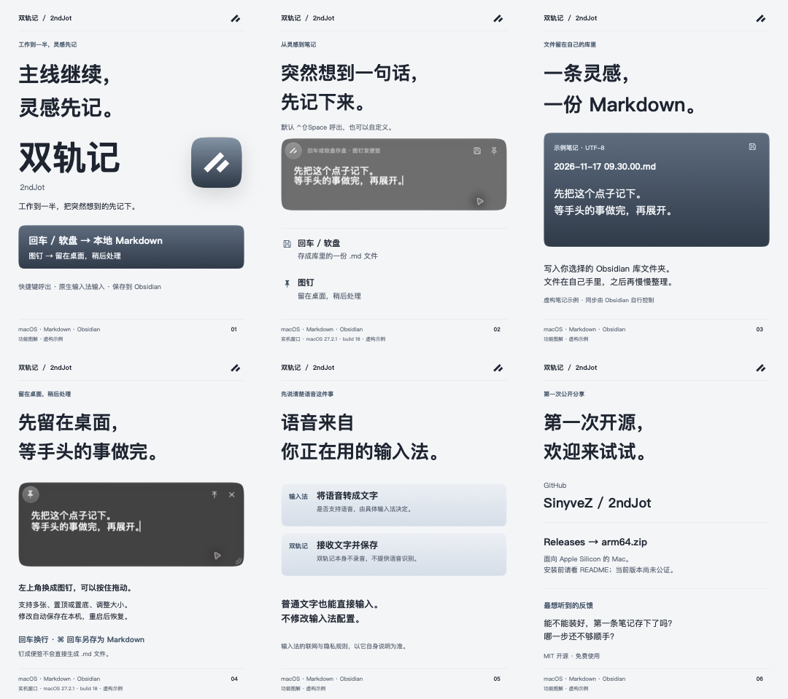

# 2ndJot · 双轨记公开前审阅

日期：2026-11-17。候选版本：1.6.0（build 18）。许可证：MIT。

**当前为私有预览：完成双语验证、私有仓库 CI 与本地体验后，再讨论公开。** 英文名为 **2ndJot**（读作 Second Jot），中文名与 D Logo 不变。目标仓库 `SinyveZ/2ndJot` 保持私有，不在本阶段发布公开 Release 或宣传帖。

## 审阅材料

| 材料 | 审阅重点 |
| --- | --- |
| [English README](../../README.md) / [中文 README](../../README.zh-CN.md) | 用途、两种去向、语言选择与当前私有体验方式 |
| [双语首发说明](RELEASE_v1.6.0.md) | 将来公开使用的正文、附件、签名与支持范围 |
| [小红书首篇正文与六图](XIAOHONGSHU.md) | 公开后使用的第一人称文案、真实窗口与下载指引 |
| [GitHub 页面文案](GITHUB_COPY.md) | 简介、Topics、Social preview、中英文反馈入口 |
| [英文传播包](INTERNATIONAL.md) | 英文首发帖、社区介绍与 FAQ |
| [验证记录](VERIFICATION.md) | 实际本地／云端运行与未覆盖范围；不以本文代替结果 |

## build 18 的文档基线

| 项目 | 约定与核对范围 |
| --- | --- |
| 品牌与文件名 | `2ndJot.app`；`2ndJot-1.6.0-{arm64,source}.zip`；源码根 `2ndJot-source` |
| 双语界面 | 中英文各 182 条资源，默认跟随系统；General → App language 即时切换 |
| 切换保留 | 正文、自定义提示、快捷键、库路径和两组玻璃设置；不写系统 `AppleLanguages` |
| 本地检查设计 | 22 个场景 × 中英文，共 44 个；另有资源与两组几何检查，实际结果读验证记录 |
| CI 检查设计 | 构建、签名与打包资源、两组几何、中英文假库保存；与完整 GUI 检查分开记录 |
| MIT 与归档 | 许可随应用资源打包；ZIP 保留 UTF-8 文件名和可执行权限；公开前再核对最终制品 |
| 安装说明 | SHA-256、ad-hoc／未公证说明、Obsidian 库要求、当前共享包或源码入口 |
| 配图 | 最终核对为 build 18 的中英文窗口；历史批准板只作参考，不能冒充当前品牌或截图 |

兼容标识 `com.sinyve.YinSu`、`YinSu` 可执行文件及原本机目录继续保留，真实笔记不移动、不改名。公开源码采用白名单导出，不携带本机旧 Git 历史、旧 dist 或私人数据；最终导出后重新检查。

## 公开前的检查点

1. **私有库真实 CI 结果。** 从验证记录读取对应提交、运行链接和 SDK，不用本地构建或工作流配置代替远端成功。当前本地环境为 Apple Silicon / macOS 27.2.1 / SDK 27.2。
2. **双语实际窗口。** 检查中英文设置、菜单、提示、错误、窄窗口和较长文字；确认切换即时生效且不改已有内容。系统对话框按 macOS 语言显示，不作为应用漏译。
3. **另一台 Mac 首次下载试装。** 当前 ad-hoc、未公证；从下载开始验证系统提示、手动打开、选库、首条保存和便签恢复。跨机首次安装尚未验证，不能宣称已通过。
4. **独立的公开确认。** 当前授权止于私有预览。确认公开后才改变可见性、建立标签及 Release；再核对图片、三个附件、校验值和反馈入口，替换 README 的私有预览提示。

Developer ID 与 Apple 公证尚未具备；Intel、其他 macOS 实机和自动更新未列为已完成能力。最低 target 13 是构建配置，不是完整兼容认证。所有最终通过／失败结论由 [VERIFICATION.md](VERIFICATION.md) 记录。

## 公开后如何介绍项目

先让 GitHub 页面讲清用途、安装和反馈，再到需要它的社区介绍。Topics 和分享封面可以帮助别人辨认项目，不能保证曝光。参考 [GitHub Topics](https://docs.github.com/en/repositories/managing-your-repositorys-settings-and-features/customizing-your-repository/classifying-your-repository-with-topics)、[Social preview](https://docs.github.com/en/repositories/managing-your-repositorys-settings-and-features/customizing-your-repository/customizing-your-repositorys-social-media-preview) 及 [Open Source Guides](https://opensource.guide/finding-users/)。

| 环节 | 2ndJot 的做法 |
| --- | --- |
| 让人看懂 | 一句话说明工作中冒出的想法如何存 Markdown 或钉为便签，配真实窗口 |
| 让人能试 | 公开后用 Releases 提供安装包，写清首次选库、语言与安装限制 |
| 找到使用者 | 中文用小红书；英文用相关 Mac／Obsidian 社区，先核对各自规则 |
| 保持可信 | 回答安装、保存和内容保留问题，记录真实修复，不承诺固定更新频率 |

D0 为实际公开日：首篇图文；D+3～5 根据首批问题补真实上手演示；D+10～14 有真实反馈或修复再更新。英文使用独立文案与 FAQ，不直接贴中文首篇。没有新信息就不硬发。

先看用户能否独立装好、存下第一条，再参考访问、下载和 Star。这些数字不能直接等同于实际使用人数；不需要为宣传加入应用内统计。

第一次使用 GitHub，先区分四个入口：**仓库**放源码与 README，**Release**提供安装附件，**Issue**接收问题，**Pull request**供他人提交修改。私有阶段只有获得访问权限的人能使用相应仓库入口。
