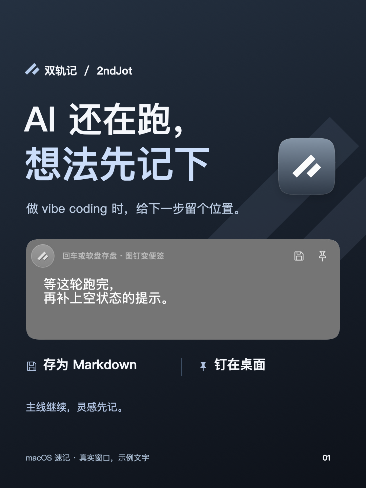

# 双轨记 · 2ndJot 首发审阅

2026-11-18 · 1.6.0（build 18）私有预览 · MIT

这次首发讲的是我在用 AI 做 vibe coding 时遇到的问题。工具还在跑当前任务，脑子已经想到下一步或另一个方向。额度和注意力都有边界，先按快捷键把想法放到本地，再决定什么时候整理或发给 AI。

| 审阅材料 | 看什么 |
| --- | --- |
| [双语 README](../../README.md) · [中文单页](../../README.zh-CN.md) · [英文部分](../../README.md#english) | 中文在前，英文完整对应。功能表和上手步骤都写明多张便签可以同时存在。 |
| [中英文 Release](RELEASE_v1.6.0.md) | 第一人称缘起、两种去向、安装和附件说明。 |
| [小红书首篇](XIAOHONGSHU.md) · [六图总览](../media/contact-sheet.png) | 首发正文、六图顺序和公开后两周的更新节奏。 |
| [GitHub 页面](GITHUB_COPY.md) · [英文社区稿](INTERNATIONAL.md) | 仓库简介和不同读者关心的试用信息。 |
| [验证记录](VERIFICATION.md) | 版本、平台、构建、测试与目前覆盖范围。 |

## 社区发布

GitHub 是项目的长期入口。README 讲清怎么用，Releases 让人下载，Issues 收集能复现的问题。首批读者通常从相关社区过来。找已经有这种工作流的人，展示一段他们能照着试的操作。 [Open Source Guides：如何找到使用者](https://opensource.guide/finding-users/)

| 渠道 | 2ndJot 适合怎么发 |
| --- | --- |
| **V2EX「分享创造」** · 中文技术用户 | 中文第一站。讲一次 AI 仍在执行而思路先往前走的经历，贴一张真实窗口和仓库链接，问愿意试的人先卡在哪一步。这个节点供作者展示自己的作品。可参考同类 Mac 工具作者如何描述自己的需求。 [节点](https://www.v2ex.com/go/create) · [Knot 的分享帖](https://global.v2ex.com/t/1242540) |
| **Obsidian Forum → Share & Showcase → Workflows & Templates** · 现有 Obsidian 用户 | 英文首轮。用三步展示「快捷键 → 输入 → 库内生成独立 .md」，再说明便签也可单独留在桌面。注明是独立的 macOS 应用，可同时留多张便签。分享后参与讨论，这里已有同类工具帖。 [板块](https://forum.obsidian.md/c/share-showcase/workflows-templates/23) · [社区准则](https://obsidian.md/help/community-code-of-conduct) · [同类发布帖](https://forum.obsidian.md/t/mac-desktop-stickies-for-obsidian/108168) |
| **Hacker News → Show HN** · 开发者和产品作者 | 等别人能直接下载试用，再由作者亲写自己为什么做、怎样试，留时间回答读者。站方要求可以操作的个人项目，帖子和评论请自己写，不使用 AI 生成文案，也不组织投票。 [Show HN 规则](https://news.ycombinator.com/showhn.html) · [HN 发帖规则](https://news.ycombinator.com/newsguidelines.html) |
| **Reddit → r/macapps 的 The App Pile** · Mac 应用使用者 | 先看当月置顶串。笔记类主版有账号和信任门槛，例如 Mac App Store、经审核的开发者标识或月串前三。开源仓库本身不构成此类主版的准入资格。月串按 Problem、Comparison、Pricing 写，比较两款实际用过的非 Apple 同类工具，注明免费与 MIT，链接给项目介绍页。 [版主规则](https://www.reddit.com/r/macapps/comments/1xo5ky1/rmacapps_moderation_update_phase_4_clearer_rules/) · [月串样例](https://www.reddit.com/r/macapps/comments/1xks9uj/megathread_the_app_pile_november_2026/) |
| **Product Hunt** · 偏广的产品尝鲜用户 | 可做第二波。在安装和演示稳定之后，用个人账号填写产品链接、短介绍、Logo 和图组。平台允许作者自己提交产品。 [官方上架说明](https://help.producthunt.com/en/articles/17734646-8-launch-faq-and-myths) |

## 建议顺序

1. **公开日**，检查外部访客能打开仓库、下载应用和找到首次打开说明，再发小红书首篇。
2. **第 1～3 天**，在 V2EX 发中文作者帖，在 Obsidian 论坛发一条英文工作流帖。两边重点分别是 AI 思路暂存和 Markdown 进库，错开发便于跟回复。
3. **第 3～5 天**，把真实反馈最多的那一步做成小红书短演示。已有顺利试装和首次保存的反馈，再考虑 Show HN。
4. **第 10～14 天**，有重复提问或真实修复时再跟进。按届时的月串规则决定是否在 r/macapps 分享。Product Hunt 可以等使用演示更完整后再考虑。

第一轮先看人能否装好、存下一条 Markdown、同时保留两张便签。发现问题就补 README 或修应用。Stars 和下载次数可以作为参考，反馈要具体到用户在哪一步停住。

## 公开前核对

最终稿需等公开授权后投放。实际下载名、校验文件、版本标签与图 6 一起核对。打包和 CI 结果见[验证记录](VERIFICATION.md)，在另一台 Mac 试装的结果另行记录。Apple Silicon 应用包未公证，首次打开说明在 Release 和 README 中各保留一处入口。
